# PHPFramework Development Roadmap

This document describes the long-term direction of PHPFramework. The goal is to turn the current educational MVC project into a reusable application core for several future web projects.

The framework should remain understandable and educational, but it should also develop the architectural qualities expected from a real platform: clear boundaries, replaceable infrastructure, automated setup, testability, security, observability, and predictable deployment.

## Vision

PHPFramework should provide the common foundation for multiple applications while keeping project-specific business logic outside the framework core.

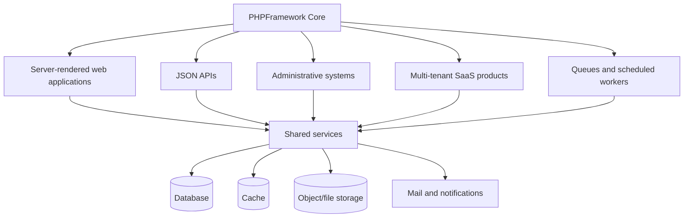

The framework should own the application lifecycle and infrastructure. Individual projects should own their domain models, business rules, UI, and deployment configuration.

## Current foundation

The project already contains the beginning of this foundation:

- PSR-4 autoloading for `PHPFramework` and `App`.
- Environment-based configuration.
- An MVC structure.
- Routing and middleware.
- Sessions, CSRF protection, authentication, and validation.
- Database access through PDO.
- Database-backed caching.
- Layouts and partial views.
- Docker-based local development.
- A development test lab.
- Audit logging for test actions.

The current implementation is intentionally compact. The roadmap below separates improvements into stages so that complexity is introduced deliberately rather than all at once.

## Architectural principles

### Framework code and project code must remain separate

The `core/` directory should contain reusable framework behavior. The `app/` directory should contain behavior specific to the current project. A feature that is useful only to one product should not be added to the core merely because it is technically convenient.

### Infrastructure should be replaceable

Database, cache, mail, file storage, queues, and logging should be accessed through contracts or stable interfaces. A project should be able to switch from a local file cache to Redis without rewriting controllers.

### Controllers should coordinate, not contain the whole application

Controllers should receive validated input, call application services, and return a response. Business rules should live in services, policies, domain objects, or repositories.

### Security should be enabled by default

CSRF protection, escaping, secure session settings, password hashing, authorization, rate limiting, and safe error handling should be framework defaults. Dangerous development tools must require an explicit environment flag and must never be enabled by default in production.

### Every important feature should be testable

The framework should make it possible to replace infrastructure with fakes or in-memory implementations during tests. Manual tools such as the test lab are useful for exploration, but automated tests should protect the framework from regressions.

## Roadmap overview

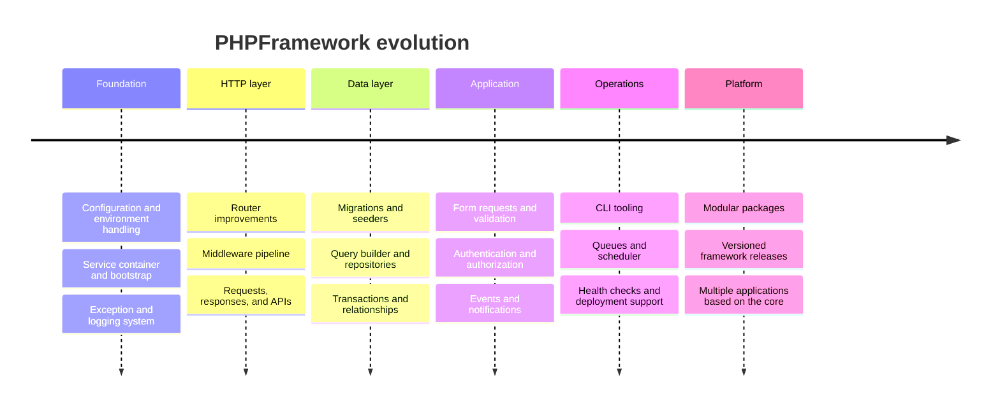

# Roadmap

## Phase 1: Service container and application bootstrap

### What it is

A service container is the central registry responsible for creating and providing application services. The application bootstrap is the sequence that prepares those services before a request is handled.

The current application creates services directly in the `Application` constructor. The next step is to move service creation into a container and let the application request services from it.

### Why it matters

Without a container, controllers and framework classes tend to construct their own database connections, caches, loggers, and other dependencies. That creates tight coupling and makes testing difficult.

With a container, a controller depends on an abstraction or service rather than knowing how that service is constructed.

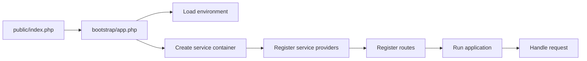

### Planned capabilities

- `bind()` for creating a new instance when requested.
- `singleton()` for reusing one instance during the request.
- Lazy service creation.
- Constructor dependency injection.
- Service providers for framework and project registrations.
- Separate bootstrap files for local, test, and production environments.
- A small compatibility layer so existing helpers such as `db()`, `cache()`, and `session()` resolve services from the container.

### Important decision

The container should not become a hidden global dumping ground. Service registration should be explicit, names should be stable, and dependencies should remain visible in constructors.

## Phase 2: HTTP lifecycle and routing

### What it is

The HTTP layer should represent a complete request lifecycle: receiving a request, matching a route, running middleware, invoking a controller, and producing a response.

### Planned capabilities

- Route parameters such as `/users/{id}`.
- Named routes and URL generation.
- Route groups and prefixes.
- Middleware groups.
- Route constraints.
- RESTful resource routes.
- Dedicated response objects for HTML, JSON, redirects, files, and streams.
- A middleware pipeline that wraps the controller action.
- Route listing through the CLI.

### Target flow

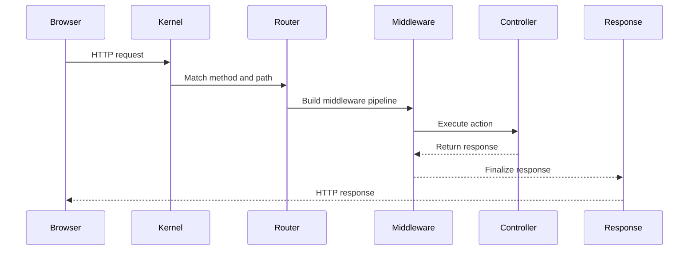

### Important decision

Middleware should run after a route has been matched, but before the controller is executed. This allows middleware to access route information and keeps route matching separate from request execution.

## Phase 3: Configuration and environment management

### What it is

Configuration should be loaded once during bootstrap and then exposed as a typed configuration system. Environment variables should provide deployment-specific values, while configuration files should describe application structure and defaults.

### Planned capabilities

- Environment files for local development and examples.
- Typed configuration values.
- Configuration namespaces such as `database`, `cache`, `mail`, and `security`.
- Configuration validation at startup.
- Environment-specific configuration.
- Production configuration caching.
- A safe command for displaying non-secret configuration.

### Example configuration structure

```text
config/
    app.php
    database.php
    cache.php
    mail.php
    security.php
    queue.php
```

### Important decision

Secrets should come from the environment or a secret manager. They should never be committed to the repository or exposed through the test lab.

## Phase 4: Database migrations, seeders, and data access

### What it is

The current schema file is useful for initial setup, but migrations are required when several applications and versions share the framework.

Migrations describe incremental schema changes. Seeders create predictable development and test data.

### Planned capabilities

- Migration files with `up()` and `down()` methods.
- A migrations table.
- Database seeding.
- Separate development, test, and production data strategies.
- Query builder with parameter binding.
- Repository and query object patterns.
- Transaction closures.
- Multiple database connections.
- Soft deletes and timestamps.
- Relationship helpers.

### Data access direction

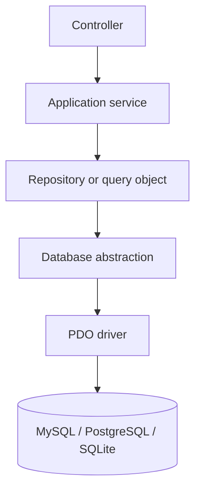

### Important decisions

- Keep SQL available for complex queries instead of forcing every query through an ORM.
- Use parameter binding for values and strict whitelists for dynamic table or column identifiers.
- Keep transactions explicit at the application-service boundary.
- Do not allow models to become containers for unrelated business logic.

## Phase 5: Validation, forms, and application services

### What it is

Validation should move out of controllers into reusable request or form objects. Application services should coordinate complete use cases such as registration, publishing an article, or processing an order.

### Planned capabilities

- Form request objects.
- Input normalization.
- Reusable validation rules.
- Authorization checks inside requests or policies.
- Consistent error bags.
- Application services for use cases.
- Domain exceptions for expected business failures.

### Example use-case structure

```text
RegisterUserRequest
        |
        v
RegisterUserService
        |
        +--> UserRepository
        +--> PasswordHasher
        +--> EventDispatcher
```

This keeps a controller small and makes registration reusable from both an HTML form and an API endpoint.

## Phase 6: Authentication and authorization

### What it is

Authentication answers “who is the user?”. Authorization answers “what is the user allowed to do?”. These concerns should be separated.

### Planned capabilities

- User sessions.
- Roles and permissions.
- Policies for resource-level access.
- Password reset.
- Email verification.
- Remember-me authentication.
- Login throttling.
- Account lockout and security events.
- Two-factor authentication.
- API tokens.
- Audit logging.

### Authorization model

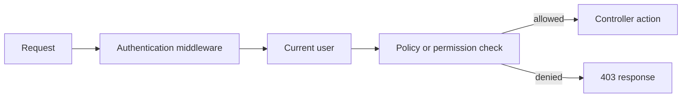

### Important decision

Permissions should be checked close to the action they protect. A route-level role check is useful, but resource policies are needed for rules such as “a user may edit only their own document”.

## Phase 7: Views, components, and frontend integration

### What it is

The view system should support reusable UI without forcing every project to adopt a separate frontend framework.

### Planned capabilities

- Nested layouts.
- View sections and slots.
- Reusable components.
- View composers.
- Asset versioning.
- Localization with fallback languages.
- Form components with automatic validation errors.
- Server-side rendering combined with optional JavaScript enhancements.
- Optional API-driven frontend support.

### Frontend strategy

The default stack should remain server-rendered PHP with Bootstrap or a project-selected CSS system. Projects that need richer interfaces can add TypeScript and a frontend framework without changing the server-side core.

## Phase 8: Events, notifications, queues, and scheduling

### What it is

Some actions should not block a web request. Sending mail, generating exports, processing images, or delivering webhooks should run as jobs.

### Planned capabilities

- Event dispatcher.
- Listeners.
- Database-backed queue.
- Redis queue driver later.
- Retry and failure handling.
- Scheduled commands.
- Email and notification channels.
- Webhook delivery with signatures.

### Example

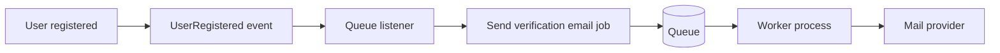

### Important decision

Every queued job must be idempotent. If a worker retries a job, repeating it should not corrupt data or send uncontrolled duplicates.

## Phase 9: Cache, logging, and observability

### What it is

The framework should make performance and failures visible without requiring every project to build its own diagnostic system.

### Planned capabilities

- Cache contracts and drivers.
- File, database, array, and Redis cache drivers.
- Cache tags and invalidation.
- Structured logging.
- Log levels and channels.
- Request IDs.
- SQL query timing in development.
- Exception reporting.
- Health checks.
- Metrics and basic tracing hooks.
- Test-lab inspection of routes, cache, services, and recent logs.

### Important decision

The test lab is a development console, not a production administration panel. It should be disabled or heavily restricted in production.

## Phase 10: CLI and developer tooling

### What it is

A framework intended to support many projects needs a command-line interface. Repetitive tasks should be predictable and automated.

### Planned commands

```bash
php framework make:controller UserController
php framework make:model Article
php framework make:migration create_articles_table
php framework migrate
php framework db:seed
php framework route:list
php framework cache:clear
php framework queue:work
php framework test
```

### Important decision

Commands should use the same service container and configuration as web requests. This prevents the CLI and HTTP application from having different behavior.

## Phase 11: Testing strategy

### What it is

Testing should protect both the framework core and the applications built on top of it.

### Planned layers

- Unit tests for small classes and domain rules.
- Integration tests for repositories and database queries.
- HTTP tests for routes and middleware.
- Authentication and authorization tests.
- View rendering tests.
- Queue and event tests.
- End-to-end browser tests for critical user journeys.

### Test environments

```text
tests/
    Unit/
    Integration/
    Feature/
    Browser/
```

The test lab should help developers manually explore behavior, while the automated test suite should provide repeatable guarantees.

## Phase 12: Modular packages and framework releases

### What it is

Once several projects use the framework, reusable features should become packages or modules.

### Possible package boundaries

```text
framework-core
framework-auth
framework-admin
framework-api
framework-media
framework-billing
framework-notifications
```

### Planned capabilities

- Package discovery.
- Package service providers.
- Package migrations and routes.
- Semantic versioning.
- Upgrade notes.
- Backward-compatibility policy.
- Release automation.

The framework should eventually be installable by a new project rather than copied manually.

# Future projects

The following projects are intended to exercise different capabilities of the framework. They are not all required immediately. Each project should be started only when the framework has reached the stage needed to support it cleanly.

## Project 1: Framework administration console

### Purpose

A reusable administration panel for managing users, roles, permissions, audit events, system health, cache, jobs, and configuration status.

### Main features

- User and role management.
- Permission matrix.
- Audit log browser.
- Database health and migration status.
- Queue monitoring.
- Failed job retrying.
- Cache inspection.
- Request and exception logs.
- Feature flags.

### Technological stack

- PHP 8.2+.
- PHPFramework MVC core.
- MySQL or PostgreSQL.
- Bootstrap initially; optional TypeScript enhancements.
- Redis for cache and queues.
- Docker Compose for local services.
- PHPUnit or Pest for automated tests.

### Patterns and decisions

- Policy pattern for administrative authorization.
- Repository pattern for searchable audit data.
- Service layer for actions such as retrying a job or clearing a cache namespace.
- Server-side pagination for large logs.
- Read-only diagnostic pages for dangerous infrastructure operations.
- Explicit confirmation and audit logging for destructive actions.

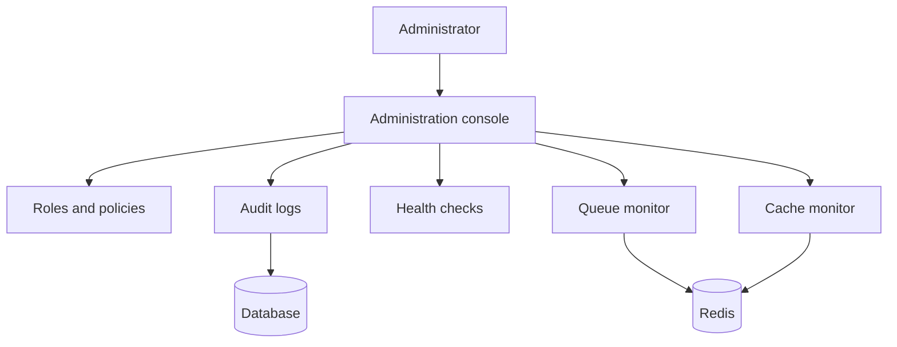

## Project 2: Content management and publishing platform

### Purpose

A modular CMS for blogs, documentation sites, news portals, and marketing websites.

### Main features

- Pages, articles, categories, tags, and authors.
- Draft and published states.
- Scheduled publishing.
- Revision history.
- Media library.
- SEO metadata.
- Multi-language content.
- Public server-side rendered pages.
- Optional JSON API.

### Technological stack

- PHPFramework MVC core.
- PostgreSQL for content and search-friendly queries.
- Object storage such as S3-compatible storage for media.
- Redis for page and fragment cache.
- Meilisearch or OpenSearch for full-text search.
- Bootstrap or Tailwind CSS for project UI.
- Queue workers for image resizing and scheduled publishing.

### Patterns and decisions

- State pattern for draft, scheduled, published, and archived content.
- Repository and query object patterns for filtering content.
- Event-driven publishing workflow.
- Immutable revision records rather than overwriting published content.
- Cache invalidation by tags when content changes.
- Object storage abstraction so local development can use filesystem storage.

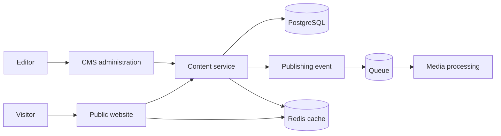

## Project 3: Multi-tenant SaaS workspace

### Purpose

A subscription-based application where multiple organizations use the same platform while their data remains isolated.

### Example product

A project-management, CRM, inventory, or internal operations platform.

### Main features

- Organizations and members.
- Tenant-specific roles and permissions.
- Invitations.
- Subscription plans.
- Usage limits.
- Billing events.
- Tenant-specific branding.
- Activity feeds.
- API access.

### Technological stack

- PHPFramework MVC and API layers.
- PostgreSQL.
- Redis for sessions, cache, rate limiting, and queues.
- Stripe Billing or another payment provider.
- Docker for local development.
- S3-compatible storage for tenant files.
- TypeScript frontend where interactive workflows require it.

### Patterns and decisions

- Tenant context resolved by middleware.
- Every tenant-owned query must include tenant scope.
- Policy checks must consider both user and tenant membership.
- Start with shared database and tenant IDs; move to separate schemas or databases only when scale or compliance requires it.
- Use an outbox pattern for reliable billing and webhook events.
- Use idempotency keys for payment and external API operations.

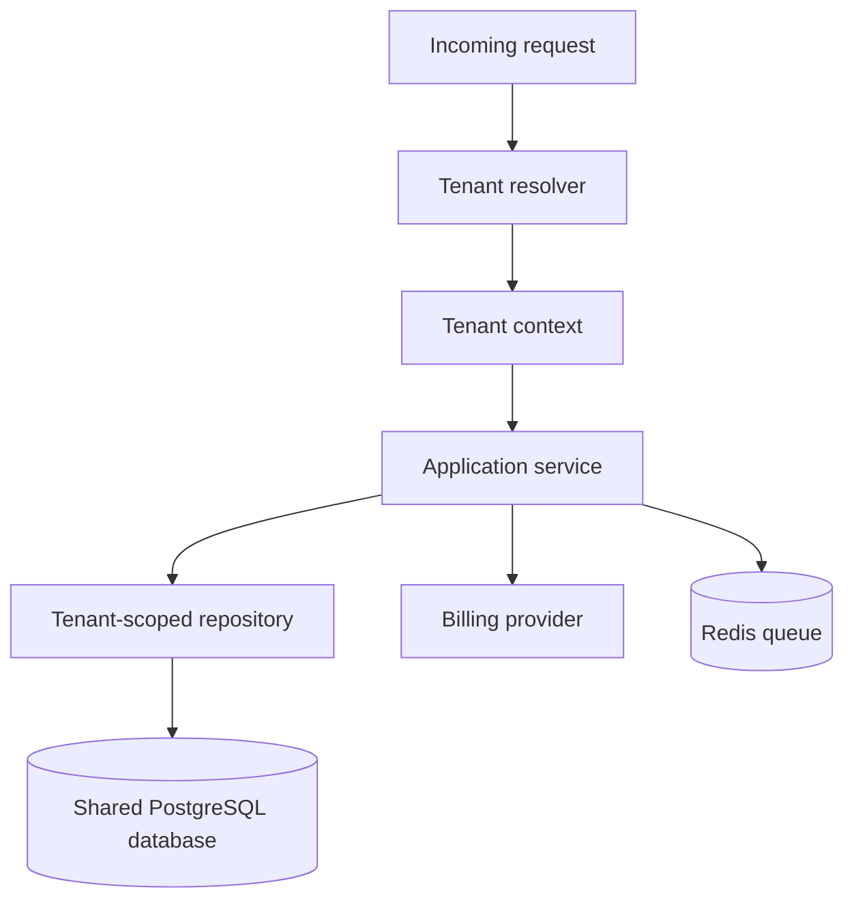

## Project 4: Commerce and order management system

### Purpose

A commerce platform that exercises transactions, inventory, payments, notifications, and asynchronous workflows.

### Main features

- Product catalog.
- Variants and prices.
- Inventory reservations.
- Cart and checkout.
- Orders and refunds.
- Payment provider integration.
- Discount rules.
- Shipment tracking.
- Customer notifications.

### Technological stack

- PHPFramework core.
- PostgreSQL or MySQL.
- Redis for carts, locks, and short-lived reservations.
- Stripe or another payment provider.
- Queue workers for mail, webhooks, and fulfillment.
- S3-compatible storage for product media.
- Search engine for product discovery.

### Patterns and decisions

- Transaction boundary around order creation.
- State machine for order status.
- Reservation model for inventory rather than immediately decrementing stock.
- Outbox pattern for payment and fulfillment events.
- Idempotent webhook processing.
- Money represented as integer minor units, never floating-point values.
- Separate catalog read models from transactional order data when search load grows.

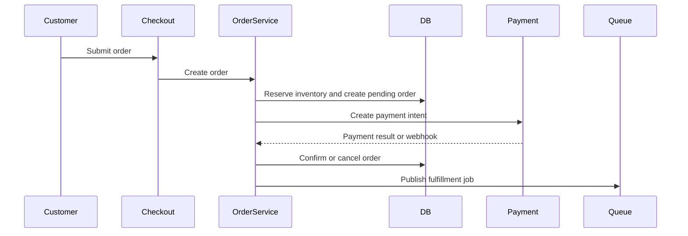

## Project 5: Booking and scheduling platform

### Purpose

A system for appointments, rooms, equipment, lessons, or other time-based reservations.

### Main features

- Resources and availability.
- Time zones.
- Recurring schedules.
- Booking and cancellation rules.
- Conflict detection.
- Reminders.
- Calendar synchronization.
- Staff and customer roles.
- Payment deposits.

### Technological stack

- PHPFramework MVC and API support.
- PostgreSQL for date-range queries and transactional consistency.
- Redis for short-lived booking locks.
- Queue workers for reminders and integrations.
- iCalendar integration.
- Optional Google Calendar or Microsoft Graph integration.
- Bootstrap or a TypeScript calendar interface.

### Patterns and decisions

- Store timestamps in UTC and convert only at the UI boundary.
- Use database transactions and constraints to prevent double booking.
- Use a temporary lock during checkout.
- Represent availability as rules and exceptions rather than pre-generating every possible slot.
- Use domain services for conflict detection.
- Treat external calendar synchronization as eventually consistent.

## Project 6: Developer API and integration hub

### Purpose

A backend for mobile applications, third-party integrations, webhooks, and automation.

### Main features

- Versioned JSON API.
- API tokens and scopes.
- OAuth clients.
- Webhooks.
- Request signing.
- Rate limiting.
- OpenAPI documentation.
- Import and export jobs.
- Integration event logs.

### Technological stack

- PHPFramework API layer.
- PostgreSQL.
- Redis for rate limiting and queues.
- OpenAPI specification.
- Symfony HTTP client or Guzzle for outbound requests.
- Queue workers for webhook delivery.
- Docker and CI-based deployments.

### Patterns and decisions

- API versioning through URL or media type.
- Resource transformers rather than exposing database models directly.
- Idempotency keys for write requests.
- Exponential retry with dead-letter handling for webhooks.
- Per-client rate limits.
- Stable error format for all API responses.

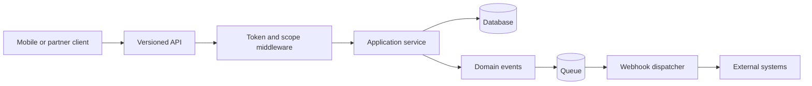

# Shared technology strategy

## Base stack

- PHP 8.2 or newer when the framework drops PHP 8.0 support.
- Composer and PSR-4 autoloading.
- PDO as the low-level database access layer.
- MySQL, PostgreSQL, and SQLite support.
- Docker Compose for local development.
- PHPUnit or Pest for testing.
- PHPStan or Psalm for static analysis.
- PHP_CodeSniffer or PHP-CS-Fixer for code quality.
- GitHub Actions or another CI system for automated checks.

## Infrastructure progression

```text
Local development:
    PHP + Docker Compose + MySQL/PostgreSQL + file cache

Small production application:
    PHP-FPM + Nginx + PostgreSQL + Redis + object storage

Growing application:
    PHP workers + Redis queues + managed database + monitoring

Large application:
    Separate read/write concerns + dedicated workers + search + tracing
```

The framework should not assume that every project needs the largest architecture. It should provide simple defaults and allow each project to adopt more advanced infrastructure when the problem justifies it.

# Decision register

These decisions should be revisited deliberately rather than made implicitly during implementation.

| Decision | Initial direction | Reason |
|---|---|---|
| Dependency management | Service container and constructor injection | Reduces global coupling and improves testing |
| Database abstraction | PDO plus query builder and repositories | Keeps SQL available while improving reuse |
| ORM strategy | Optional, not mandatory | Different projects need different data access styles |
| Cache strategy | Driver-based cache contracts | Enables file, database, and Redis implementations |
| Queue strategy | Database first, Redis later | Keeps the first implementation simple |
| Frontend strategy | Server-rendered by default | Low deployment complexity and good educational value |
| API strategy | Separate response and resource layer | Prevents database models leaking into public APIs |
| Multi-tenancy | Shared database with tenant scope first | Lower operational cost and simpler initial deployment |
| Search | Database search first, external engine when needed | Avoids premature infrastructure |
| Deployment | Docker Compose locally, CI/CD for production | Reproducible environments |
| Test lab | Development-only and environment-controlled | Prevents dangerous tools from reaching production |
| Framework distribution | Versioned package or monorepo modules | Allows multiple projects to share improvements |

# Recommended implementation order

The most valuable sequence is:

1. Service container and bootstrap.
2. Middleware pipeline and route improvements.
3. Migrations, seeders, and safer database abstractions.
4. Form requests and application services.
5. Authentication, roles, and policies.
6. CLI commands.
7. Automated testing foundation.
8. Events, queues, and notifications.
9. Cache, logging, and health checks.
10. Modular packages and framework versioning.
11. Administration console.
12. CMS, SaaS, commerce, booking, and API projects.

The framework should be considered successful when a new project can be created with a small amount of project-specific code, while the difficult infrastructure decisions are already solved by the core.
